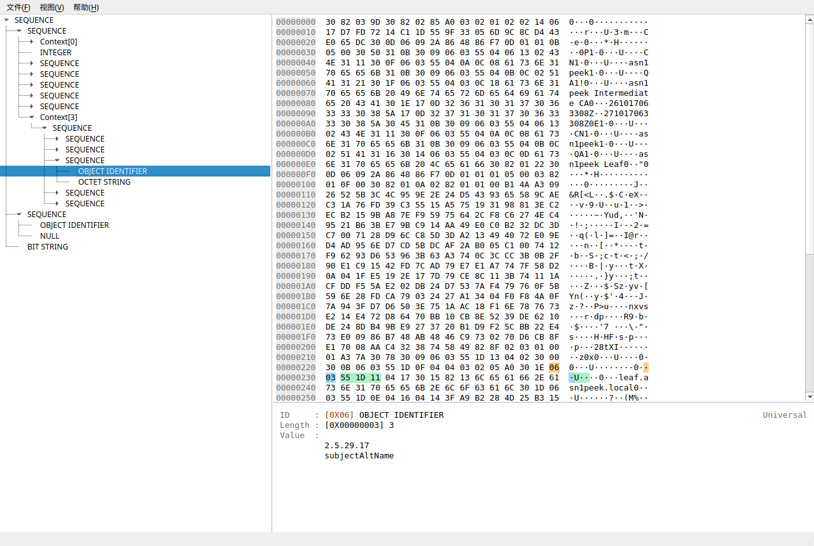

# asn1peek

**Linux 桌面端 ASN.1 数据查看器：树状结构 + Hex 字节联动 + 一键提取。**

用于查看证书、证书链、CSR、PKCS#7 或任意 DER/BER 数据：在树中展开结构，在 Hex
视图中对照原始字节，并把需要的节点复制出来。



## 功能

- **打开即看**：自动识别 DER、PEM、裸 Base64、Hex 文本；支持文件对话框、拖拽、
  剪贴板粘贴和命令行参数。
- **结构与字节联动**：选中树节点后，Hex 视图按 tag / length / value 三色高亮；
  点击 Hex 任意字节可反向定位最内层节点。
- **懒解析**：容器子节点在展开时才解析，大文件打开和滚动保持流畅。
- **PKI 友好**：内嵌 DER 探测（如 PKCS#7 中的证书、SPKI 中的 RSA 公钥）、OID
  名称库、常见扩展名、证书链多根节点展示。
- **一键拿走**：复制解析值、完整 TLV（Hex/Base64）、节点路径、dumpasn1 风格
  子树文本。

## 环境要求

- Linux
- Python 3.11+
- [uv](https://docs.astral.sh/uv/)（推荐）或 pip
- 运行测试和重建样例需要 `openssl`

AppImage 已包含运行环境，不需要安装 Python。

## 从源码运行

```bash
git clone https://github.com/2856672598/asn1peek.git
cd asn1peek
uv sync
uv run asn1peek samples/leaf.der
```

也可以直接以模块方式运行：

```bash
uv run python -m asn1peek samples/chain.pem
```

使用普通 venv：

```bash
python -m venv .venv
. .venv/bin/activate
pip install -e .
asn1peek samples/certs.p7b
```

## 构建

### wheel / sdist

```bash
uv build
# 产物位于 dist/
```

### AppImage

```bash
uv sync --group build
./scripts/build_appimage.sh
# 产物：dist/asn1peek-<版本>-<架构>.AppImage
```

脚本会自动下载 `appimagetool` 和 AppImage type2 运行时到 `tools/bin/`（首次构建
需要联网）。

发行版建议使用 Ubuntu 22.04 基线构建（GLIBC 2.35，无根 chroot）：

```bash
uv python install 3.13
UV_PROJECT_ENVIRONMENT=build/.venv-pbs313 uv sync --python 3.13 --group build
./scripts/build_appimage_jammy.sh
```

## 测试

```bash
uv sync --group dev
uv run pytest
uv run ruff check .
uv run ruff format --check .
```

UI 测试默认使用 Qt 的 `offscreen` 平台，不需要显示器。

真实窗口冒烟（可选）：

```bash
QT_QPA_PLATFORM=xcb uv run python scripts/smoke_ui.py \
  samples/leaf.der subjectAltName /tmp/asn1peek-smoke.png
```

重建样例（会生成新密钥，需要 `openssl`）：

```bash
./scripts/make_samples.sh
```

## 使用

```text
asn1peek [file]
```

常用操作：

| 操作 | 快捷键 / 入口 |
| --- | --- |
| 打开文件 | `Ctrl+O`、拖入窗口、`asn1peek <file>` |
| 粘贴解析 | `Ctrl+V`（PEM / Base64 / Hex 全文均可） |
| 复制节点值 | `Ctrl+C` 或树右键「复制值」 |
| 复制节点路径 | `Ctrl+Shift+C` |
| 复制子树文本 | 树右键「复制子树文本」 |
| 重新解析 | `F5` |
| 展开/折叠 | 方向键、树右键「展开到此处 / 折叠全部」 |
| 显示长度/偏移列 | 「视图」菜单 |
| 显示连接线 | 「视图 → 显示连接线」 |
| 显示解码信息 | 「视图 → 显示解码信息」 |

支持的输入形态：

| 形态 | 说明 |
| --- | --- |
| DER / BER / CER | 自描述 TLV，无需 schema；支持不定长和 EOC |
| PEM | 可包含多段（证书链、PKCS#7 等），逐段解析为并列根节点 |
| Base64 | 裸 Base64 文本 |
| Hex | 带空白分隔的十六进制文本 |
| 剪贴板 | 自动按上述格式识别 |

## 项目结构

```text
src/asn1peek/
├── core/                  # 纯 Python 解析引擎（无 GUI 依赖）
│   ├── model.py           # Asn1Node / Asn1Document / ValueInfo
│   ├── parser.py          # TLV 解析、懒解析、错误恢复、安全上限
│   ├── decode.py          # OID / 时间 / 字符串 / BOOLEAN / NULL 解码
│   ├── oid.py             # OID 名称库
│   ├── sniff.py           # DER / PEM / Base64 / Hex 识别
│   └── export.py          # 原始字节复制、子树文本、值区转储
├── ui/                    # PySide6 视图与 Qt 接线
│   ├── main_window.py     # 主窗口与联动
│   ├── tree_model.py      # 懒解析树模型
│   ├── tree_view.py       # 连接线绘制
│   ├── hex_view.py        # 三色高亮与反向定位
│   ├── detail_panel.py    # ID / Length / Value 详情
│   └── ...
└── app.py                 # 命令行入口

tests/                     # pytest：core 单测、openssl 对照、UI 全链路
tools/build_oids.py        # dumpasn1.cfg → JSON OID 库
packaging/                 # .desktop / AppRun / PyInstaller 入口
scripts/                   # 样例、冒烟、打包、安装脚本
samples/                   # 自包含的 PKI 测试样例
assets/                    # 图标与 README 截图
```

## 许可证

本项目采用 [MIT License](LICENSE)。

运行时使用 PySide6（Qt for Python），以 LGPLv3 动态链接方式使用；其许可证与版权
归 Qt Company 及贡献者所有。
